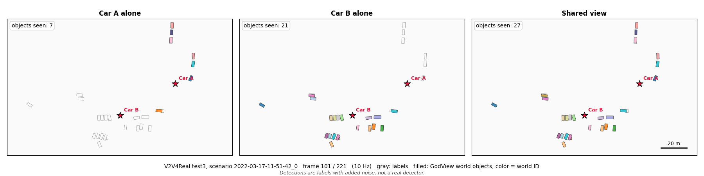

# V2V4Real replay, test1 split (version 1 detections)

Measured 2026-11-05 on branch `feat/v2v4real-replay`. "Before" is the
first replay; "After" adds the declared systematic box errors of commit
17c51aa (merged from `feat/boxes-ids-real-data`). Raw numbers:
`docs/results/v2v4real_summary.json`. Data format findings:
`docs/PHASE_C_HANDOFF.md`, "Findings".

## What was run

* Data: V2V4Real test1, 3 scenarios (`09-54-40_0`, `10-29-43_3`,
  `10-29-43_4`; 147, 114 and 144 frames), two real cars each. Frames are
  replayed at 10 Hz (assumed from the paper; the files have no timestamps).
* Each car is one GodView `PerceptionNode`, fed through the same JSON-lines
  parser as `godview-node` (`godview_node::input::parse_line`). Peer batches
  arrive 100 ms after publishing. Default `NodeConfig` everywhere, except in
  the runs marked "no size gate" (a diagnostic, not a proposed setting) and
  the "After" runs, which set the tracker's `box_size_sys_m` and
  `box_yaw_sys_rad` (all gates on).
* Detections (version 1): a car detects a labeled box if the box is within
  120 m and holds at least 5 of the car's own lidar points; the detection is
  the label plus seeded Gaussian noise (position 0.3 m, size 0.2 m, heading
  3 degrees, all declared). **This is not a real detector.** Visibility and
  occlusion come from the real lidar, but positions, sizes and headings come
  from human labels. Version 2 (boxes from the car's own points) is not done.
* All vehicle types map to one class id, because the cars disagree on class
  for one object (Van and Truck) and GodView fuses only equal classes.
* Earth anchor: each scenario's map frame is placed on the Earth by a rigid
  fit of `lidar_pose` to the dataset's gps field (residual 0.16 to 0.22 m
  rms horizontally). Both cars and the truth use the same anchor, so its
  error cancels; it is not a made-up position.
* Truth: the union of both cars' labels, linked by `ass_id`. An object's
  position is the mean of the labels of the cars that labeled it, its size
  the mean size, its heading that of the car with more lidar points on it.
* Scoring per car and frame: Hungarian matching against every labeled
  object, 5 m cutoff. An object is expected if some car detected it in this
  frame and the 3 frames before. Each car is excluded from its own truth.
  * Duplicate: an extra estimate within 5 m of a labeled object, so the
    object appears twice. "Split" means the two estimates come from
    different cars.
  * False: an extra estimate farther than 5 m from every label.
  * Gained: an object in a car's world that the car's own sensor never
    detected up to that frame.
  * ID change: the world ID matched to an object differs from the one
    matched last time.

## Pose uncertainty declarations

| declaration | sigma h (per axis) / v | how it was chosen |
|---|---|---|
| (a) nominal | 1.27 / 2.0 m, yaw 0.1 deg | Datasheet, standalone GNSS (no RTK is documented for V2V4Real). OxTS RT3000 v3: SPS position 1.5 m CEP, which is 1.27 m per axis for a circular Gaussian, and heading 0.1 deg 1 sigma. The NovAtel E1 family sheet gives 1.5 m RMS single point L1, so 1.27 m covers it as well. Vertical 2.0 m is an assumption: neither sheet found gives a vertical figure. |
| (b) from 09-54-40_0 | 0.73 / 0.93 m | Leave one out. sigma_h = sqrt(E\|d_h\|^2 / 4) and sigma_v = sqrt(E[d_z^2] / 2) over the relative offsets d of objects both cars labeled in that scenario, so that two independent cars' difference is calibrated. Scored on the other two. |
| (b) from 10-29-43_3 | 1.31 / 2.33 m | Same rule. |
| (b) from 10-29-43_4 | 0.29 / 0.57 m | Same rule. |
| reference RTK | 0.01 / 0.02 m | RT3000 headline RTK figure. Not a candidate: the measured offsets rule it out. Shown to make the failure mode visible. |

Yaw sigma is 0.1 deg in every declaration. GodView applies pose yaw error
about the odometry origin (here the scenario's mean car position), not about
the car, so the lever arm is the distance to that point (detections are up to 167
to 180 m from it) instead of the range from the sensor. At 0.1 deg this adds
at most about 0.3 m; the mismatch itself is not measured.

Sources for the datasheet figures: the V2V4Real project page lists the units
(Tesla: RT3000, Ford: NovAtel SPAN E1) but gives no accuracy figures
(https://mobility-lab.seas.ucla.edu/?p=2004). The RT3000 v3 datasheet
(https://positics.fr/wp-content/uploads/2020/09/RT3000-V3.pdf, read through
search results) gives SPS 1.5 m CEP, RTK 0.01 m and heading 0.1 deg. The
NovAtel PwrPak7-E1 sheet
(https://www.navtechgps.com/wp-content/uploads/PwrPak7-E1_DS.pdf) gives
single point L1 1.5 m RMS. The exact unit version and correction mode used
in the dataset are not documented. The V2V4Real paper itself could not be
fetched (too large).

## Before: results, default configuration

No systematic box errors declared.

Counts are summed over both cars and the scored scenarios. RMS and NEES are
given as "all matched / objects labeled by both cars". Only the second is
informative about pose: for an object only one car labeled, the truth went
through that car's own pose, so the pose error cancels.

| declaration | scored on | matched | missed | duplicates (split) | false (coasting) | RMS m | NEES 3D (expect 3) | NEES horiz (2) / vert (1) | both detect: fused into one | ID changes / objects | gained objects (object-frames) |
|---|---|---|---|---|---|---|---|---|---|---|---|
| (a) nominal | all 3 | 3001 | 3 | 385 (327) | 392 (369) | 0.93 / 1.41 | 0.35 / 0.79 | 0.24 / 0.12 | 742 / 997 | 118 / 50 = 2.36 | 18 (679) |
| (b) from 40_0 | 43_3, 43_4 | 1846 | 0 | 368 (306) | 345 (322) | 0.97 / 1.74 | 1.26 / 4.02 | 0.67 / 0.60 | 147 / 424 | 98 / 34 = 2.88 | 12 (389) |
| (b) from 43_3 | 40_0, 43_4 | 1833 | 3 | 143 (111) | 107 (107) | 0.72 / 0.98 | 0.21 / 0.37 | 0.17 / 0.04 | 607 / 697 | 53 / 28 = 1.89 | 11 (426) |
| (b) from 43_4 | 40_0, 43_3 | 2323 | 3 | 393 (342) | 381 (358) | 0.99 / 1.44 | 4.73 / 9.98 | 3.34 / 1.39 | 611 / 873 | 109 / 38 = 2.87 | 13 (543) |
| reference RTK | all 3 | 3001 | 3 | 994 (908) | 424 (401) | 0.87 / 1.31 | 15.94 / 36.87 | 6.83 / 9.11 | 177 / 997 | 234 / 50 = 4.68 | 18 (679) |

Boxes (default configuration, nominal): box size NEES 3.35 (expect 3).
Heading error median 1.6 to 2.1 deg per car and scenario, 95th percentile at
most 8.0 deg, maximum 46.5 deg. The maximum is the turning car that car 0
misannotated (see Findings).

Per scenario, nominal declaration, default configuration:

| scenario | car | matched | duplicates | false | RMS both-labeled m | NEES 3D both-labeled | fused / both detect | ID changes / objects |
|---|---|---|---|---|---|---|---|---|
| 09-54-40_0 | 0 | 579 | 18 | 32 | 1.00 | 0.44 | 284 / 287 | 8 / 8 |
| 09-54-40_0 | 1 | 576 | 19 | 32 | 1.07 | 0.51 | 284 / 286 | 7 / 8 |
| 10-29-43_3 | 0 | 584 | 119 | 143 | 2.08 | 1.65 | 66 / 150 | 35 / 11 |
| 10-29-43_3 | 1 | 584 | 123 | 142 | 2.02 | 1.56 | 69 / 150 | 30 / 11 |
| 10-29-43_4 | 0 | 339 | 56 | 21 | 0.66 | 0.15 | 17 / 62 | 23 / 6 |
| 10-29-43_4 | 1 | 339 | 50 | 22 | 0.68 | 0.15 | 22 / 62 | 15 / 6 |

## Before: diagnostics

Size gate disabled in the world model (everything else the same):

| declaration | fused / both detect | duplicates (split) | ID changes / objects |
|---|---|---|---|
| (a) nominal | 895 / 997 (was 742) | 202 (147) (was 385 (327)) | 62 / 50 = 1.24 (was 2.36) |
| (b) from 40_0 | 303 / 424 (was 147) | 194 (135) | 43 / 34 = 1.26 |
| (b) from 43_3 | 684 / 697 (was 607) | 66 (34) | 20 / 28 = 0.71 |
| (b) from 43_4 | 629 / 873 (was 611) | 359 (311) | 100 / 38 = 2.63 |

Horizontal and vertical sigma crossed (smallest and largest leave-one-out
values), scored on 09-54-40_0 and 10-29-43_3, objects both cars detect that
were fused into one:

| sigma h / v | default config | no size gate | NEES horiz / vert |
|---|---|---|---|
| 1.31 / 2.33 | 703 / 873 | 779 / 873 | 0.27 / 0.10 |
| 1.31 / 0.57 | 661 / 873 | 722 / 873 | 0.27 / 1.44 |
| 0.29 / 2.33 | 633 / 873 | 703 / 873 | 3.36 / 0.10 |
| 0.29 / 0.57 | 611 / 873 | 629 / 873 | 3.34 / 1.39 |

## After: declared systematic box size and heading errors

Commit 17c51aa adds `box_size_sys_m` (m, every dimension) and
`box_yaw_sys_rad` to the tracker configuration. They are added to the
published box variances, so two sources' converged tracks keep a floor on
their size and heading uncertainty. The replay sets them in `NodeConfig`
(the JSON-lines input has no field for them).

**Rule, leave one out like the pose sigma.** From one scenario, over every
pair-frame of an object both cars labeled: the per-axis size differences of
the two cars' labels (length, width, height) are pooled into one sample, and
its standard deviation divided by sqrt(2) is `box_size_sys_m`. The same on
the heading difference gives `box_yaw_sys_rad`. The values are scored on the
other two scenarios, with the nominal pose and with the leave-one-out pose
from the same scenario. All gates on.

| chosen from | pair-frames (objects) | box_size_sys_m | box_yaw_sys | notes |
|---|---|---|---|---|
| 09-54-40_0 | 290 (2) | 0.049 m | 3.08 deg | both objects' sizes agree to 0.1 to 0.2 m |
| 10-29-43_3 | 170 (5) | 0.181 m | 1.74 deg | turning car excluded from heading (below) |
| 10-29-43_4 | 62 (1) | 0.183 m | 1.47 deg | one object; its sizes differ by a constant -0.03, -0.02, +0.52 m, so the value comes from the spread across its three axes, not over time |

The misannotated turning car (car 0 id 3, 10-29-43_3) is reported
separately: 33 pair-frames with heading differences of 0.9 to 47.7 deg.
Including it would set the heading value from 10-29-43_3 to 8.01 deg instead
of 1.74. (33 pair-frames here against 17 in the Findings, because the
converter links the car 1 label for the whole scenario once `ass_id` links
it.)

Results, all gates on. The "no size gate" reference is the "Before"
diagnostic on the same scored scenarios with the same pose sigma.

| systematic from | pose | scored on | matched | missed | duplicates (split) | false (coasting) | RMS m | NEES 3D | NEES horiz / vert | fused / both detect | no size gate reference | box size NEES (expect 3) | ID changes / objects |
|---|---|---|---|---|---|---|---|---|---|---|---|---|---|
| 40_0 | nominal | 43_3, 43_4 | 1846 | 0 | 244 (192) | 327 (304) | 1.01 / 1.83 | 0.39 / 1.26 | 0.24 / 0.15 | 268 / 424 | 327 / 424 | 2.85 | 76 / 34 = 2.24 |
| 40_0 | (b) 0.73 / 0.93 | 43_3, 43_4 | 1846 | 0 | 267 (205) | 342 (319) | 0.99 / 1.79 | 1.31 / 4.22 | 0.68 / 0.63 | 240 / 424 | 303 / 424 | 2.82 | 67 / 34 = 1.97 |
| 43_3 | nominal | 40_0, 43_4 | 1833 | 3 | 66 (34) | 107 (107) | 0.72 / 0.98 | 0.23 / 0.42 | 0.18 / 0.06 | 684 / 697 | 684 / 697 | 0.50 | 20 / 28 = 0.71 |
| 43_3 | (b) 1.31 / 2.33 | 40_0, 43_4 | 1833 | 3 | 66 (34) | 107 (107) | 0.72 / 0.98 | 0.21 / 0.37 | 0.17 / 0.04 | 684 / 697 | 684 / 697 | 0.50 | 20 / 28 = 0.71 |
| 43_4 | nominal | 40_0, 43_3 | 2310 | 16 | 173 (144) | 313 (305) | 1.05 / 1.52 | 0.44 / 0.92 | 0.29 / 0.15 | 779 / 873 | 779 / 873 | 0.53 | 57 / 38 = 1.50 |
| 43_4 | (b) 0.29 / 0.57 | 40_0, 43_3 | 2323 | 3 | 359 (311) | 361 (358) | 1.00 / 1.45 | 4.78 / 10.09 | 3.37 / 1.42 | 629 / 873 | 629 / 873 | 0.54 | 100 / 38 = 2.63 |

RMS and NEES as before: all matched / objects labeled by both cars. Same
scored scenarios before the declaration (default configuration, nominal
pose): fused 174 / 424, 607 / 697 and 703 / 873; ID changes per object
3.03, 1.89 and 2.11; box size NEES 3.94, 2.94 and 3.19.

What this shows:

* **With 0.18 m declared, the size gate stops splitting objects.** On every
  scored scenario the counts (matched, missed, duplicates, false, fused, ID
  changes) are identical to the run with the size gate disabled, for both
  cars. Every scenario is scored with 0.181 or 0.183 m in one of the runs,
  so the nominal pose over all three scenarios gives exactly the diagnostic's
  895 of 997 fused and ID changes per object fall from 2.36 to 1.24, with
  the size gate still on.
* **The value from 09-54-40_0 (0.049 m) is too small for the other two.**
  Fusion rises from 174 to 268 of 424 but stays below 327 without the gate.
  That scenario has only two linked cars whose labels agree closely; the
  rule cannot see the 1.06 m disagreement in 10-29-43_3.
* **0.18 m overcovers the size.** Box size NEES falls from about 3 to 0.50
  to 0.54. The size truth is the mean of the two labels, so each car's size
  error relative to it is half the disagreement, and half of the 8 linked
  objects disagree by about 0.2 m or less on every axis; the declaration is
  set by the few that disagree by 0.5 to 1.06 m. With 0.049 m, size NEES is 2.82 to 2.85.
* **The heading declaration changes no association count.** The remaining
  splits in 10-29-43_3 come from the heading gate on the turning car (up to
  47.7 deg apart, far beyond 1.47 to 3.08 deg) and from the velocity gate.
  An 8.01 deg declaration (turning car included) was not tested.
* **The pose declaration still decides the rest.** The leave-one-out pose
  from 10-29-43_4 (0.29 m) still gives 629 of 873 and NEES 10.09 on
  both-labeled objects; the box declaration cannot fix an understated pose.

## Held-out confirmation (test2, test3)

### Frozen settings

Fixed on 2026-11-05, before test2 and test3 were downloaded, and committed
before any of their data was read. No setting may change after the results
are seen.

* Pose: nominal declaration, 1.27 m horizontal (per axis), 2.0 m vertical,
  0.1 deg yaw.
* Tracker: `box_size_sys_m` 0.18, `box_yaw_sys_rad` 1.7 deg (0.02967 rad).
* All gates on; everything else default (`NodeConfig::default()`).
* Converter and replay unchanged from the test1 runs: version 1 detections
  (labels of boxes with at least 5 own lidar points within 120 m, plus
  seeded noise of 0.3 m, 0.2 m and 3 deg, seed 1), 10 Hz, 100 ms delivery
  delay, 5 m cutoff, the same expected-object rule and the same scoring.

### Data and format check

* test2 (`test_02.zip`, 1228581180 bytes) and test3 (`test_03.zip`,
  1551328836 bytes) were downloaded through the same Box endpoint; sizes
  match the listing, no path in either zip escapes its directory. Six
  scenarios, 1588 frames: `2022-03-17-10-50-46_0` (198), `10-50-46_1` (180),
  `11-02-23_1` (310) in test2; `2022-03-17-11-02-23_2` (304), `11-51-42_0`
  (221), `2022-03-21-09-35-07_7` (375) in test3.
* Matches the Findings: the same frame and label keys; labels in each car's
  lidar frame (100% of 565 sampled boxes hold at least 5 points with
  `extent` as half size, 36% and 53% as full size); yaw is `angle[1]` in
  degrees added to the pose yaw; `location` is the box center; `center` is
  always zero and `ego_speed` always 0; numeric label IDs are per car and
  `ass_id` on car 1 holds the car 0 ID (every linked target is present in
  the same frame); gps heading equals pose yaw plus 1.00 deg (car 0) and
  2.50 deg (car 1) in every frame; the relative offset is again a slowly
  varying common offset.
* Differences from test1 (scripts in `scripts/v2v4real/verify/`):
  1. **Front/back flips across cars.** 292 pair-frames in which the two
     cars' headings for one object differ by more than 165 deg (8 objects
     in 3 scenarios; 170 of them one object in `10-50-46_1`). test1 had
     none. Within one car, 2 single-frame flips and some heading steps of
     20 to 80 deg between consecutive frames.
  2. **More object types**: Pedestrian (801 labels), Bus, Van, BicycleRider,
     Scooter. The converter maps every type to one class id, as for test1.
  3. **Denser scenes**: 17 (test2) and 14 (test3) labels per car and frame
     against 3 in test1;
     171 linked objects against 8.
  4. **`ass_id` links some car 1 labels to two car 0 IDs over time** (7
     labels in `10-50-46_1` and `11-02-23_1`). The converter's rule (a car 1
     label linked once is linked to the lowest car 0 ID for the whole
     scenario) then pairs it with the wrong object in some frames. test1 had
     none. One such label hides the largest size disagreement found (car 0:
     ConcreteTruck 22.7 m long; car 1: Truck 6.8 m).
  5. **Possible missing links**: up to 93 car 1 label-frames per scenario without
     `ass_id` lie within 3 m of an unlinked car 0 label (for example a
     pedestrian pair 1.3 m apart for 60 frames in `11-02-23_1`).
  6. **Stationary cars**: both cars stand still in `10-50-46_1` and
     `09-35-07_7` and move about 0.1 m per frame in `11-51-42_0`. There the
     gps fit has 0.99 m rms residual (others 0.07 to 0.28 m) and car 0's
     gps heading offset is -1.29 deg (others -0.36 to -0.24 deg), so that
     scenario's Earth anchor is poorer.
  7. Labels per car reach 70 to 132 m (test1: 72 to 130 m).

### Results with the frozen settings (run once)

Same columns as before. RMS and NEES as "all matched / objects labeled by
both cars". Counts are summed over both cars. `docs/results/v2v4real_heldout_summary.json`.

| scenario | frames | matched | missed | duplicates (split) | false (coasting) | RMS m | NEES 3D (expect 3) | NEES horiz / vert | fused / both detect | box size NEES (expect 3) | heading err median / p95 / max deg | ID changes / objects | gained objects (object-frames) |
|---|---|---|---|---|---|---|---|---|---|---|---|---|---|
| 10-50-46_0 | 198 | 4763 | 10 | 380 (202) | 1184 (1103) | 0.83 / 1.17 | 0.36 / 0.72 | 0.33 / 0.04 | 1585 / 1753 | 0.85 | 1.8-1.9 / 6.3 / 179.9 | 57 / 114 = 0.50 | 53 (825) |
| 10-50-46_1 | 180 | 10818 | 141 | 521 (480) | 372 (366) | 0.56 / 0.53 | 0.16 / 0.12 | 0.13 / 0.02 | 6254 / 6794 | 1.55 | 1.8-2.0 / 10.8 / 180.0 | 270 / 106 = 2.55 | 32 (1625) |
| 11-02-23_1 | 310 | 14813 | 188 | 1497 (1011) | 2787 (2667) | 0.71 / 0.98 | 0.26 / 0.51 | 0.23 / 0.03 | 3748 / 4413 | 1.71 | 1.8-2.0 / 8.0 / 180.0 | 419 / 246 = 1.70 | 109 (3867) |
| 11-02-23_2 | 304 | 6426 | 148 | 646 (554) | 788 (754) | 0.71 / 0.78 | 0.24 / 0.29 | 0.19 / 0.04 | 4089 / 4362 | 2.14 | 1.9 / 6.8 / 180.0 | 162 / 105 = 1.54 | 41 (454) |
| 11-51-42_0 | 221 | 11000 | 0 | 107 (13) | 268 (268) | 0.38 / 1.14 | 0.08 / 0.74 | 0.07 / 0.01 | 379 / 398 | 0.31 | 1.6 / 5.3 / 180.0 | 16 / 71 = 0.23 | 33 (5086) |
| 09-35-07_7 | 375 | 14279 | 15 | 81 (68) | 280 (273) | 0.41 / 0.45 | 0.07 / 0.09 | 0.06 / 0.02 | 8739 / 8770 | 1.55 | 1.6-1.8 / 5.3 / 11.5 | 63 / 55 = 1.15 | 12 (2270) |
| **total** | 1588 | 62099 | 502 | 3232 (2328) | 5679 (5431) | 0.59 / 0.71 | 0.17 / 0.25 | 0.15 / 0.02 | 24794 / 26490 | 1.38 | 1.6-2.0 / 10.8 / 180.0 | 987 / 697 = 1.42 | 280 (14127) |
| test1, same settings | 405 | 2988 | 16 | 202 (147) | 354 (346) | 0.95 / 1.45 | 0.37 / 0.82 | 0.24 / 0.12 | 895 / 997 | 0.57 | 1.5-2.1 / 8.0 / 46.5 | 62 / 50 = 1.24 | 18 (668) |

(The test1 row reruns test1 with exactly the frozen values; the earlier
test1 runs used 1.47 or 1.74 deg for the heading term. It is a reference,
not held out.)

Per-frame relative pose offset (the same object labeled by both cars, each
placed with its own car's pose; ENU, car 0 minus car 1; per-frame means in
the JSON, `scenarios.<name>.relative_offset.per_frame`):

| scenario | pairs | mean E, N, U m | std E, N, U m | median \|horiz\| m | p95 \|horiz\| m | max \|horiz\| m | p95 \|vert\| m | per-frame mean \|horiz\| m |
|---|---|---|---|---|---|---|---|---|
| 10-50-46_0 | 888 | -0.14, 1.37, -0.57 | 0.29, 1.36, 0.86 | 1.22 | 3.33 | 5.33 | 2.13 | 0.25 to 3.49 |
| 10-50-46_1 | 3534 | -0.03, -0.01, 0.03 | 0.29, 0.40, 0.64 | 0.33 | 0.88 | 3.30 | 1.17 | 0.03 to 0.69 |
| 11-02-23_1 | 2286 | 0.16, -0.51, 0.00 | 0.46, 1.48, 0.77 | 1.05 | 2.97 | 6.36 | 1.57 | 0.02 to 1.63 |
| 11-02-23_2 | 2212 | 0.07, -0.40, -0.07 | 0.37, 0.92, 0.88 | 0.64 | 2.08 | 8.49 | 1.74 | 0.02 to 1.60 |
| 11-51-42_0 | 207 | 0.38, 0.68, 0.15 | 1.67, 0.91, 0.57 | 1.62 | 3.66 | 4.15 | 0.96 | 0.56 to 2.40 |
| 09-35-07_7 | 4997 | 0.14, 0.05, 0.02 | 0.30, 0.25, 0.53 | 0.26 | 0.86 | 3.81 | 1.18 | 0.04 to 0.37 |

106 of 14124 pair-frames exceed 4 m. The 8.49 m pair grows from 4.6 to
8.5 m over 4 frames, which looks like one car's label lagging rather than a
pose error (not verified).

Size and heading disagreement of linked objects (both cars' labels of one
object, all pair-frames; the rule value is what the leave-one-out rule
would give, reported only):

| scenario | objects (pair-frames) | \|size diff\| L, W, H median m | p95 m | max m | objects > 0.5 m / > 1 m | size rule value m | \|heading diff\| median / p95 deg | objects with a flip (pair-frames) | heading rule value without flips deg |
|---|---|---|---|---|---|---|---|---|---|
| 10-50-46_0 | 26 (888) | 0.18, 0.13, 0.05 | 0.91, 0.38, 0.18 | 0.91, 0.56, 0.23 | 5 / 0 | 0.172 | 1.8 / 8.4 | 0 (0) | 2.63 |
| 10-50-46_1 | 31 (3534) | 0.20, 0.10, 0.06 | 1.17, 0.43, 0.41 | 1.33, 0.67, 0.49 | 7 / 4 | 0.203 | 1.5 / 170.9 | 3 (191) | 5.59 |
| 11-02-23_1 | 57 (2286) | 0.36, 0.14, 0.14 | 1.27, 0.48, 0.39 | 1.65, 0.91, 0.88 | 35 / 18 | 0.266 | 2.4 / 12.1 | 2 (52) | 3.57 |
| 11-02-23_2 | 33 (2212) | 0.20, 0.14, 0.14 | 0.90, 0.49, 0.38 | 1.25, 0.61, 0.50 | 17 / 3 | 0.191 | 1.9 / 9.4 | 3 (49) | 2.68 |
| 11-51-42_0 | 5 (207) | 0.14, 0.05, 0.07 | 0.48, 0.20, 0.18 | 0.48, 0.22, 0.27 | 0 / 0 | 0.100 | 2.0 / 6.3 | 0 (0) | 1.97 |
| 09-35-07_7 | 19 (4997) | 0.24, 0.16, 0.08 | 0.81, 0.45, 0.55 | 1.56, 0.83, 0.55 | 7 / 1 | 0.194 | 1.3 / 3.7 | 0 (0) | 1.40 |

The frozen values (0.18 m, 1.7 deg) fall inside the range the rule gives
on the held-out scenarios (0.10 to 0.27 m; 1.4 to 5.6 deg without flips).

### What the held-out run shows

1. **The test1 result holds up.** 24794 of 26490 objects both cars detect
   become one world object (93.6%; test1 with the same settings: 89.8%).
   Missed expected objects: 502 of 62601 (0.8%). 23% of matched
   object-frames are objects the car's own sensor had never detected (14127
   of 62099; test1: 22%).
2. **The pose sigma overcovers here.** NEES on objects both cars labeled is
   0.25 in total (0.09 to 0.74 per scenario), against 3 expected. The
   held-out relative offsets are smaller than test1's (median 0.26 to 1.62 m
   against 0.54 to 2.11 m). This is the expected cost of a conservative
   fixed declaration, and the same variation that made the leave-one-out
   pose sigma fail on test1.
3. **Box size NEES is 1.38** (0.31 to 2.14 per scenario): the 0.18 m
   declaration overcovers less here than on test1 (0.57), because the
   held-out annotators disagree more.
4. **ID changes: 1.42 per object** (0.23 to 2.55 per scenario).

### Explanations (diagnostics only; no setting was changed)

These come from extra replays with gates switched off and from a dump of
which objects were missed or shown twice (`--diag`,
`scripts/v2v4real/diagnose_heldout.py`). They explain the frozen result; the
frozen result above is the one reported.

* **Heading error up to 180 deg** in five scenarios: the cross-car
  front/back flips (difference 1). The fused heading follows one car and
  the truth follows the car with more lidar points.
* **What splits objects.** With the box gate off, cross-car duplicates fall
  from 2328 to 1156 (heading part alone: 2328 to 1488; size part alone: 2328
  to 1812); the velocity gate adds little (2328 to 2241). Of all 3232
  duplicate object-frames, 896 involve a size disagreement over 0.5 m and
  432 a cross-car heading flip; 0.18 m and 1.7 deg cannot cover either. The
  gates do work: switching off the box gate raises misses from 502 to 928,
  and switching off every world gate raises them to 3050, because distinct
  objects merge.
* **Misses.** 305 of the 502 missed object-frames have another labeled
  object within 3 m in the same frame, and 90 involve a car 1 label that
  `ass_id` links to two car 0 IDs (differences 4 and 5). Most misses are
  therefore two labels for what GodView treats as one object, a limit of
  the truth construction rather than of GodView; this is a reading of the
  counts, not checked object by object.
* **False estimates** are again coasting tracks: 5431 of 5679 carry the ID
  of a previously matched object.
* **ID changes** are highest in `10-50-46_1` (2.55 per object), the scenario
  with the most flip pair-frames (191) and with pedestrians.

### Not proven by the held-out run

* Still version 1 detections (labels plus noise), not a real detector.
* The truth is still the mean of the two cars' labels; NEES is relative to
  it. The converter's link rule mislinks some objects in two scenarios
  (difference 4), which affects both truth and the label statistics there.
* Front/back flips in the labels would not occur in the same way with a
  real detector, which is more likely to be ambiguous (`yaw_ambiguous`)
  than confidently wrong; this replay declares headings as unambiguous.

## Demo video



Two real cars about 60 m apart, nearly stationary (held-out scenario
`2022-03-17-11-51-42_0`, frozen settings): alone, car A's world holds 6.7
objects per frame on average and car B's 19.4, while the shared GodView
world holds 25.0, with labels as gray outlines and GodView world objects
filled in a color fixed by their world ID. Detections are the dataset's
labels with added noise, not a real detector, so the video shows sharing,
association and fusion, not perception quality.

* Video: [`docs/media/v2v4real_shared_view.mp4`](../media/v2v4real_shared_view.mp4)
  (22.1 s, 10 Hz, 221 frames); short loop:
  [`docs/media/v2v4real_shared_view.gif`](../media/v2v4real_shared_view.gif)
  (8 s at 5 frames per second).
* 4:5 version for phones: [`docs/media/v2v4real_linkedin.mp4`](../media/v2v4real_linkedin.mp4)
  (1080x1350, 15 s, frames 41 to 190 of the same dumps; car B alone on top,
  car B's shared world below; `scripts/v2v4real/render_linkedin.py`).
* "Car A alone" and "Car B alone" come from a replay with `--no-sharing`
  (each car fuses only its own reports); "Shared view" is car 0's world in
  the normal replay (car 1's shared world is the same up to the 100 ms
  delay). "Objects seen" counts world objects inside the drawn area,
  including duplicates and coasting tracks. The dump runs reproduce the
  frozen held-out numbers exactly.
* This scenario was chosen because sharing helps most there (car A alone
  matches 6.7 labeled objects per frame, shared 24.8); in the other held-out
  scenarios the gain is smaller (for example 9.6 to 10.8 in
  `2022-03-17-11-02-23_2`).
* Reproduce:

```sh
R=target/release/v2v4real-replay; D=$V2V4REAL_DIR/converted_heldout/2022-03-17-11-51-42_0
$R --dir $D --out share.json --box-size-sys-m 0.18 --box-yaw-sys-deg 1.7 --dump share.dump
$R --dir $D --out alone.json --box-size-sys-m 0.18 --box-yaw-sys-deg 1.7 --no-sharing --dump alone.dump
python -I scripts/v2v4real/render_demo.py share.dump alone.dump docs/media v2v4real_shared_view \
    --title "V2V4Real test3, scenario 2022-03-17-11-51-42_0" --still-frame 100
```

## Relative offset between the cars, per frame

The same object, labeled by both cars and placed with each car's own pose
(ENU, car 0 minus car 1). Per-frame means are in the JSON summary
(`relative_offset.<scenario>.per_frame`).

| scenario | pairs | mean E, N, U m | std E, N, U m | median \|horiz\| m | max \|horiz\| m | per-frame mean \|horiz\|, min to max m |
|---|---|---|---|---|---|---|
| 09-54-40_0 | 290 | -0.34, 1.18, 0.25 | 0.50, 0.59, 1.29 | 1.30 | 3.91 | 0.29 to 3.89 |
| 10-29-43_3 | 170 | 0.16, 2.31, -1.10 | 0.88, 0.88, 3.11 | 2.11 | 4.46 | 0.82 to 3.85 |
| 10-29-43_4 | 62 | -0.02, -0.35, 0.24 | 0.35, 0.29, 0.77 | 0.54 | 1.36 | 0.09 to 1.36 |

These counts are a little higher than in the Findings (280, 150, 62 pairs;
largest offset 3.84 m), because the converter links a car 1 label ID to car
0 for the whole scenario once `ass_id` links it in any frame.

## Findings

1. **Sharing adds objects.** 679 of 3001 matched object-frames (23%) under
   the nominal declaration are objects the car's own sensor had never
   detected up to that frame: 18 distinct objects summed over cars and
   scenarios. Missed expected objects: 3 of 3004.
2. **An understated pose sigma creates duplicates, as the design predicts.**
   With the 1 cm RTK sigma only 177 of 997 objects both cars detect become
   one world object, against 742 under the nominal sigma. Duplicates rise
   from 385 to 994. No overconfident single object hides the problem. The
   consistency monitor never judges anyone with two cars (`min_partners` is
   3), so nothing catches it.
3. **A sigma chosen on one scenario does not transfer.** The rule that
   calibrates one scenario gives NEES on both-labeled objects of 4.02, 0.37
   and 9.98 on the other two (expect 3). The relative offset differs by a
   factor of about 4 between scenarios, even between two segments of the same
   drive (10-29-43_3 and 10-29-43_4: median 2.11 and 0.54 m). The largest leave-one-out sigma (1.31 m) is close to the
   datasheet value (1.27 m) and overcovers the other two scenarios.
4. **Vertical has to be declared on its own.** With horizontal covered (1.31
   m) and the size gate off, lowering vertical sigma from 2.33 to 0.57 m
   reduces fusion of objects both cars detect from 779 to 722 of 873
   (default configuration: 703 to 661), and vertical NEES rises from 0.11 to
   1.53 (default: 0.10 to 1.44). Most of this comes from
   10-29-43_3, where the vertical offset std is 3.1 m.
5. **The box size gate is the largest single cause of splits, even when the
   pose is covered.** The cars' annotators give the same object sizes that
   differ by up to 1.06 m. Each car's labels keep one size per object, so a
   track's size variance shrinks as it averages frames, and two converged
   tracks then fail the 99.99% size gate. Disabling only that gate raises
   nominal fusion from 742 to 895 of 997 and halves ID changes (118 to 62).
   This is the size counterpart of the systematic center error that
   `box_center_sys_frac` handles. **After:** declaring `box_size_sys_m` of
   0.18 m (leave-one-out from 10-29-43_3 or 10-29-43_4) gives exactly the
   no-size-gate association results with the gate on, at the cost of an
   overcovered size (NEES about 0.5). Whether a real detector shows the same
   effect is not tested; with version 1 the disagreement comes from the
   annotators.
6. **ID changes are frequent.** Nominal: 2.36 changes per object (22 of 50
   objects change at least once), most of them the object switching between
   one fused and two split world objects. With the size gate off, or with
   0.18 m declared: 1.24. That is still more than one change per object;
   the remaining switches come from the pose, heading and velocity gate
   splits above, so lineage IDs are still not tested against stable fusion.
7. **False estimates are coasting tracks.** 369 of 392 (nominal) carry the ID
   of an object matched earlier. They appear in runs of about 15 frames
   (1.5 s, `terminate_after_s`) after an object leaves the labeled set, for
   example at scenario 4's 72 m annotation limit. Whether those objects were
   really gone is not known.
8. **Heading.** Label headings never flip front/back in test1. The heading
   gate still splits one object in 10-29-43_3, which one car misannotated by
   up to 44 deg while it turned. In that scenario the velocity gate also
   splits some pairs (with the size and heading gates off, splits fall from
   46 to 16 frames for car 0 when the velocity gate is also off); this was
   not analyzed further.

## What is not proven

* Labels with noise are not a real detector. The results test association,
  fusion and pose handling on real geometry, real visibility and real pose
  error, not detection quality.
* There is no ground truth for the poses. The truth is the mean of the two
  cars' labels, so every number about pose accuracy is relative to the cars'
  mean, and NEES on both-labeled objects is only a consistency check against
  that mean. For single-labeled objects, NEES and RMS do not include pose
  error at all.
* 10 Hz is assumed. The 100 ms delay is a chosen value, not measured.
* Three scenarios and about 400 frames are a small sample. The leave-one-out
  result shows the pose offset varies between scenarios more than the sample
  can characterize.
* The pose yaw lever arm is modeled about the scenario origin, not the car.
* The systematic box values come from at most 5 linked objects per scenario
  (1 in 10-29-43_4), so the leave-one-out rule rests on very few objects.
* The two-process Zenoh demo (step 4, second part) is not done: `godview-node`
  stamps tracks with the input clock and expects it to be live, so the
  converter would need to rebase timestamps to the current time and a feeder
  would need to pace the lines at 10 Hz.

## Reproduce

```sh
# data: see docs/PHASE_C_HANDOFF.md (Download); about 2 minutes in total
cargo build --release -p godview_sim --bin v2v4real-replay
/workspace/venv/bin/python -I scripts/v2v4real/run_all.py \
    $V2V4REAL_DIR/test1 $V2V4REAL_DIR/converted docs/results/v2v4real_summary.json
```

The replay is deterministic: two full runs gave identical numbers.
